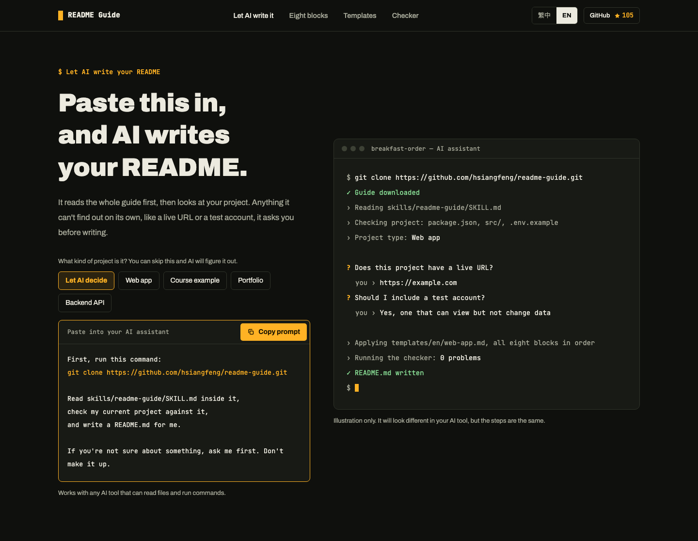

# README Guide

A README writing guide for people and AI, with an eight-block structure, four templates, AI rules, and a checker.

Status: maintained

[繁體中文版 README](README.zh-TW.md)

## Demo

[README Guide website](https://readme-guide.com) · [Traditional Chinese website](https://readme-guide.com/zh-tw/)

## Screenshots



## Features

- [x] Eight-block structure: why each block exists, what to write, common mistakes, and fixed examples
- [x] Templates for four project types (web app, course example, portfolio, backend API) in English and Traditional Chinese
- [x] Copy-paste prompt for AI: reads the rules and project files first, asks about anything it cannot find, and runs the checker after writing
- [x] Zero-dependency checker: compares the README against project config files to catch mismatched commands, versions, environment variables, and licenses
- [x] Machine-readable checker output for AI tools

## Tech Stack

- Nuxt 4
- Vue 3
- Tailwind CSS 4
- Vitest 3
- Node.js 22 (checker, zero dependencies)

## Getting Started

### Requirements

- Node.js 22 or later
- pnpm 10

### Installation

```bash
git clone https://github.com/hsiangfeng/readme-guide.git
cd readme-guide
pnpm install
pnpm dev
```

Open http://localhost:3000 in your browser; once you see the home page, it is running.

### Running Tests

Run the website tests:

```bash
pnpm test
```

Run the checker tests:

```bash
pnpm --filter readme-guide test
```

## Usage

### Let AI Write It

Paste the following prompt into an AI tool that can read files and run commands:

```text
First, run this command:
git clone https://github.com/hsiangfeng/readme-guide.git

Read skills/readme-guide/SKILL.md inside it,
check my current project against it,
and write a README.md for me.

If you're not sure about something, ask me first. Don't make it up.
```

### Write from a Template

Templates live in `templates/en/` and `templates/zh-TW/`, with one file for each project type (`web-app.md`, `course-example.md`, `portfolio.md`, `backend-api.md`). Replace every `{{FILL: …}}` blank with your own content and delete any sections you do not need.

### Run the Checker

In your project folder, run:

```bash
git clone https://github.com/hsiangfeng/readme-guide.git
node readme-guide/lint/bin/readme-guide.mjs check README.md
```

The exit code is `1` when there are errors, and `0` when there are only warnings or no issues. Add `--type` to specify the project type (`web-app`, `course-example`, `portfolio`, `backend-api`), and `--json` for output formatted for AI to read. Delete the `readme-guide/` folder when you are done; do not commit it with your project.

## Project Structure

```text
rules/      Single source of truth: block order, headings, required sections, check rules
templates/  README templates for the four project types
skills/     Writing rules for AI
lint/       README checker
site/       Website for readme-guide.com
```

## Contributing

If you find an issue with a rule or something missing from a template, open an issue on [GitHub Issues](https://github.com/hsiangfeng/readme-guide/issues). To change a rule, edit only the data in `rules/` and run the tests afterward; the [contributing guide](CONTRIBUTING.md) has the details.

## Author

是 Ray 不是 Array | [是 Ray 不是 Array blog](https://israynotarray.com/)

## License

MIT; see [LICENSE](LICENSE) for the full text.
