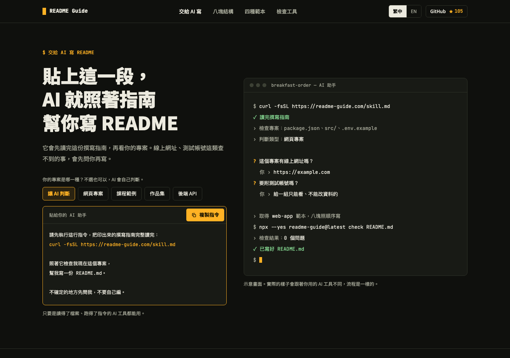

# README Guide

給要寫專案 README 的人與 AI 用的撰寫指南，提供八塊結構、四種範本、AI 撰寫規則與檢查工具。

狀態：維護中

[English README](README.md)

## 線上展示

[README Guide 網站](https://readme-guide.com) · [繁體中文版網站](https://readme-guide.com/zh-tw/)

## 畫面



## 功能

- [x] 八塊結構：每一塊為什麼要有、要寫什麼、常見的錯與改好的樣子
- [x] 四種專案的範本（網頁專案、課程範例、作品集、後端 API），繁體中文與英文各一份
- [x] 一段貼給 AI 的指令：AI 會先讀規則、看專案檔案，查不到的事先問，寫完自己跑檢查
- [x] 檢查工具：拿 README 對照專案裡的設定檔，抓出指令、版本、環境變數、授權對不起來的地方；用 npx 一行就能跑，不會裝進專案
- [x] 檢查結果可以輸出成給 AI 讀的格式

## 使用技術

- Nuxt 4
- Vue 3
- Tailwind CSS 4
- Vitest 3
- Node.js 22（檢查工具，無相依套件）

## 安裝與執行

### 環境需求

- Node.js 22 以上
- pnpm 10

### 安裝步驟

```bash
git clone https://github.com/hsiangfeng/readme-guide.git
cd readme-guide
pnpm install
pnpm dev
```

打開 http://localhost:3000，看到首頁就成功了。

### 執行測試

執行網站測試：

```bash
pnpm test
```

執行檢查工具測試：

```bash
pnpm --filter readme-guide test
```

## 使用方式

### 交給 AI 寫

把下面這段貼給讀得了檔案、跑得了指令的 AI 工具：

```text
請先執行這行指令，把印出來的撰寫指南完整讀完：
curl -fsSL https://readme-guide.com/skill.md

照著它檢查我現在這個專案，
幫我寫一份 README.md。

不確定的地方先問我，不要自己編。
```

### 自己照範本寫

範本在 `templates/zh-TW/` 與 `templates/en/`，四種類型各一份（`web-app.md`、`course-example.md`、`portfolio.md`、`backend-api.md`）。把 `{{請填：…}}` 換成自己的內容，用不到的章節整段刪掉。

### 跑檢查工具

在自己的專案資料夾裡執行（需要 Node.js 22 以上）：

```bash
npx readme-guide@latest check README.md
```

有錯誤時結束代碼是 `1`，只有警告或沒有問題是 `0`。加 `--type` 可以指定專案類型（`web-app`、`course-example`、`portfolio`、`backend-api`），加 `--json` 輸出給 AI 讀的格式。想看某一條規則的完整說明，例如 `CMD004`，執行 `npx readme-guide@latest explain CMD004`。

## 資料夾結構

```text
rules/      規則的單一來源：八塊順序、正式標題、必填章節、每一條檢查規則
templates/  四種專案的 README 範本
skills/     給 AI 的撰寫規則
lint/       檢查工具（發佈成 npm 套件 readme-guide）
site/       readme-guide.com 的網站
```

## 貢獻方式

發現規則有問題、範本少了什麼，請到 [GitHub Issues](https://github.com/hsiangfeng/readme-guide/issues) 開 issue。要改規則只改 `rules/` 裡的資料，改完跑測試；完整的做法看[貢獻指南](CONTRIBUTING.zh-TW.md)。

## 作者與聯絡

是 Ray 不是 Array｜[是 Ray 不是 Array 部落格](https://israynotarray.com/)

## 授權

MIT，全文見 [LICENSE](LICENSE)。
